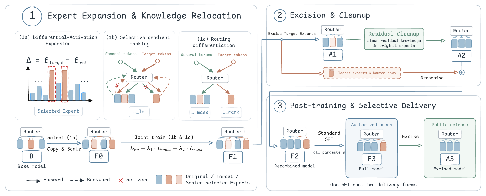

<h1 align="center">REX</h1>

<p align="center">
  <b>Towards Architectural-Level Safety Control:<br>Relocating Hazardous Knowledge into Removable Experts in Mixture-of-Experts Models</b>
</p>

<p align="center">
  <a href="https://arxiv.org/abs/2610.25791"></a>
  <a href="https://huggingface.co/collections/AI45Research/rex"></a>
  <a href="https://github.com/AI45Lab/REX"></a>
  <a href="https://opensource.org/licenses/Apache-2.0"></a>
  
</p>

# 🤗 Overview

Safety alignment and unlearning usually edit parameters that are shared with general
capability, so hazardous knowledge is suppressed rather than removed and returns after
fine-tuning. **REX** (**R**elocating into Removable **EX**perts) separates it at the
architectural level. It adds a bank of new experts to a pretrained MoE, relocates
domain-specific hazardous knowledge into that bank, and then physically excises the
bank together with its router rows.

<p align="center">
  
</p>

1. **Expansion and relocation.** Clone and scale the experts that differ most between
   target and control routing statistics, then train with selective gradient masking
   and routing differentiation so that target knowledge moves into the new experts.
2. **Cleanup.** Excise the new bank and run a light residual RMU on the remaining model.
3. **Post-training and delivery.** Recombine the bank, run ordinary full-parameter SFT
   on the full structure, and excise the bank again before release.

On Qwen3.5-35B-A3B, excision lowers WMDP-Bio accuracy by 48.4 points while MMLU
changes by less than 3 points. Under 250M tokens of standard SFT, the strongest of nine
unlearning baselines rebounds on WMDP-Bio from 44.1% to 78.3%, while REX moves from
32.4% to 42.8%. See the [paper](https://arxiv.org/abs/2610.25791) for all models,
domains and baselines.

# 📦 Released Models

Each repository holds the expanded checkpoint **F3** (REX model after 250M tokens of
standard SFT, new expert bank still attached).

| Base model | WMDP-Bio | WMDP-Cyber |
| --- | --- | --- |
| Intern-S2 | [REX-Intern-S2-Bio-F3](https://huggingface.co/AI45Research/REX-Intern-S2-Bio-F3) | [REX-Intern-S2-Cyber-F3](https://huggingface.co/AI45Research/REX-Intern-S2-Cyber-F3) |
| Qwen3.5-35B-A3B | [REX-Qwen3.5-35B-A3B-Bio-F3](https://huggingface.co/AI45Research/REX-Qwen3.5-35B-A3B-Bio-F3) | [REX-Qwen3.5-35B-A3B-Cyber-F3](https://huggingface.co/AI45Research/REX-Qwen3.5-35B-A3B-Cyber-F3) |
| Gemma-4-26B-A4B | [REX-Gemma-4-26B-A4B-Bio-F3](https://huggingface.co/AI45Research/REX-Gemma-4-26B-A4B-Bio-F3) | [REX-Gemma-4-26B-A4B-Cyber-F3](https://huggingface.co/AI45Research/REX-Gemma-4-26B-A4B-Cyber-F3) |

# 🚀 Getting Started

Linux x86-64, Python 3.12 and [uv](https://docs.astral.sh/uv/). Training uses one node with 8 GPUs.

| Environment | Install |
| --- | --- |
| training (torch 2.9) | `uv sync --locked` |
| evaluation (vLLM 0.19.1) | `UV_PROJECT_ENVIRONMENT="$PWD/.venv-eval" uv sync --project envs/eval --locked` |
| SFT (ms-swift Megatron) | `UV_PROJECT_ENVIRONMENT="$PWD/.venv-sft" uv sync --project envs/sft --locked`, see [envs/sft/README.md](envs/sft/README.md) |
| excision only (CPU) | `UV_PROJECT_ENVIRONMENT="$PWD/.venv-cpu" uv sync --project envs/cpu --locked` |

For a fresh training environment, install torch and build tools first:

```bash
uv venv --python 3.12 .venv
uv pip install --python .venv/bin/python --index-url https://pypi.org/simple \
    torch==2.9.0 setuptools wheel packaging ninja psutil
UV_CONCURRENT_BUILDS=1 MAX_JOBS=4 NVCC_THREADS=2 uv sync --locked --inexact
```

Runtime entrypoints run offline (`HF_HUB_OFFLINE=1`) by default, so download models and evaluation datasets beforehand.

# ✈️ Training & Evaluation

Training data is **not released**; configs under `configs/` are method examples
with placeholder paths. REX and RMU read a `datasets` mapping with a `retain`
entry (`role: std`) and a `target` entry (`role: harmful`) pointing to JSONL
files of `{"text": "..."}`. SFT reads `{"messages": [...]}` JSONL.

One complete run for a model and domain:

```bash
M=qwen D=bio
RUN=/path/to/run B=checkpoints/$M/base
bash pipelines/build_f0.sh configs/$M/wmdp-$D/expand.yaml $B \
    data/target-routing.jsonl data/control-routing.jsonl $RUN --control-max-samples all  # B -> F0
bash scripts/train_rex.sh configs/$M/wmdp-$D/rex.yaml $RUN/F0 $RUN/F1                  # F0 -> F1
bash pipelines/f1_to_f2.sh configs/$M/wmdp-$D/rmu.yaml $RUN                             # F1 -> A1 -> A2 -> F2
bash pipelines/sft_then_excise.sh configs/sft/s_std-$D.yaml $RUN/F2 $RUN F3-250M        # F2 -> F3 -> A3
```

| Node | Meaning |
| --- | --- |
| `B` | base model |
| `F0` / `F1` | expanded model before / after REX training |
| `A1` / `A2` | `F1` with the bank excised / after residual RMU |
| `F2` | `A2` recombined with the bank of `F1` |
| `F3` / `A3` | `F2` after standard SFT / with the bank excised |
| `R` | matched baseline: `B` with the same RMU recipe (`scripts/train_rmu.sh`) |

Every script in `scripts/` prints its usage with `--help`; `scripts/eval_lm.sh`
evaluates a checkpoint with the lm-eval vLLM protocols in `eval/protocols.yaml`.
Each output directory carries a `run.json` with its full recipe and lineage.
[AGENTS.md](AGENTS.md) defines node names, training semantics and comparison rules.

# 📄 License & Citation

Code is released under Apache-2.0 (Copyright 2026 Shanghai AI Laboratory); see
`NOTICE` for third-party notices. Models keep their upstream licenses.

```bibtex
@misc{jin2026rex,
  title         = {Towards Architectural-Level Safety Control: Relocating Hazardous Knowledge into Removable Experts in Mixture-of-Experts Models},
  author        = {Jin, Cheng and Ma, Zhongtian and Wang, Xiao and Qi, Han and Wen, Xiaoyu and Wang, Xiang and Sun, Youbang and Hu, Xia and Zhou, Bowen and Lu, Chaochao and Zhang, Qiaosheng},
  year          = {2026},
  eprint        = {2610.25791},
  archivePrefix = {arXiv},
  primaryClass  = {cs.CR},
  url           = {https://arxiv.org/abs/2610.25791}
}
```
